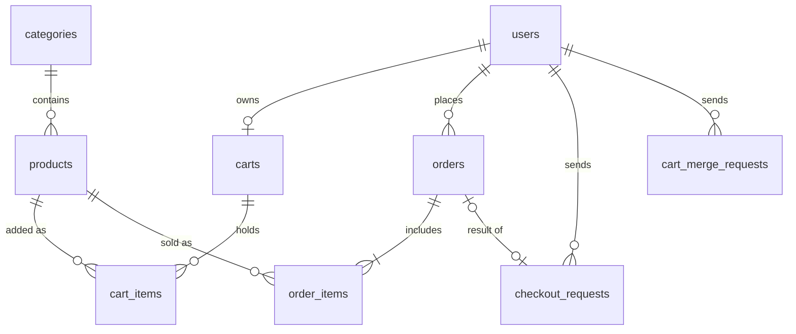

# Backend database setup (SCRUM-19)

## Decisions

| Item | Choice | Reason |
| --- | --- | --- |
| Database | MySQL | Agreed by the team; relational constraints fit customers, carts and orders; familiar from the Database Systems course. |
| Driver | `mysql2` | Standard MySQL driver for Node.js. |
| Migrations / queries | Knex | Stays close to SQL, keeps schema changes as versioned files in Git, easy to review. |
| Tested with | MySQL 26.10.0 (Homebrew), Node.js 26 | |

## One-time local setup

1. **Install and start MySQL.** macOS: `brew install mysql` then `brew services start mysql`. Windows/Linux: install MySQL Community Server and start the service.
2. **Create the databases and the app user** (run once as root: `mysql -u root -p`). Choose your own password:
   ```sql
   CREATE DATABASE IF NOT EXISTS dobby_dev  CHARACTER SET utf8mb4 COLLATE utf8mb4_0900_ai_ci;
   CREATE DATABASE IF NOT EXISTS dobby_test CHARACTER SET utf8mb4 COLLATE utf8mb4_0900_ai_ci;
   CREATE USER IF NOT EXISTS 'dobby_app'@'localhost' IDENTIFIED BY 'your_password';
   GRANT ALL PRIVILEGES ON dobby_dev.*  TO 'dobby_app'@'localhost';
   GRANT ALL PRIVILEGES ON dobby_test.* TO 'dobby_app'@'localhost';
   ```
   The app never uses `root`; `dobby_app` can only see these two databases.
3. **Create your local config** in `backend/`:
   ```sh
   cp .env.example .env
   ```
   Set `DB_PASSWORD` to the password above. Generate `SESSION_SECRET` with `openssl rand -hex 32`. `.env` is git-ignored; never commit it.
4. **Install and migrate:**
   ```sh
   npm install
   npm run migrate        # dobby_dev
   npm run migrate:test   # dobby_test
   ```
5. **Start:** `npm run dev`. Expected output:
   ```text
   Backend running on http://localhost:3001
   Database ready (dobby_dev)
   ```

## Commands

| Command | What it does |
| --- | --- |
| `npm run dev` | Start the backend with auto-restart |
| `npm run migrate` | Apply pending migrations to `dobby_dev` |
| `npm run migrate:test` | Apply pending migrations to `dobby_test` |
| `npm run migrate:status` | List applied and pending migrations |
| `npm run migrate:rollback` | Undo the last migration batch (development only) |
| `npx knex migrate:make <name>` | Create a new migration file in `db/migrations/` |
| `npm run db:reset` | **Development only.** Drop all tables in `dobby_dev` and re-run every migration |
| `npm run db:reset:test` | Same for `dobby_test` |
| `npm run seed` | Load the demo catalogue into `dobby_dev` (safe to run again) |
| `npm run seed:test` | Same for `dobby_test` |
| `npm run test:db` | Rebuild `dobby_test` from empty and run the schema constraint tests |

Starting the server never runs migrations and never drops data. `db:reset` deletes all local data and refuses to run unless the database name ends in `_dev` or `_test`.

## Schema (SCRUM-20)

Migrations in `db/migrations/`, applied in order:

| Migration | Tables |
| --- | --- |
| `20261110000001_create_users` | `users` |
| `20261110000002_create_catalog` | `categories`, `products` |
| `20261110000003_create_carts` | `carts`, `cart_items`, `cart_merge_requests` |
| `20261110000004_create_orders` | `orders`, `order_items`, `checkout_requests` |
| `20261110000005_create_sessions` | `sessions` (login sessions, SCRUM-23) |
| `20261113000001_add_response_to_cart_merge_requests` | `cart_merge_requests.response_body`: adjustments of a guest-cart merge, returned again on a retry (SCRUM-32) |



### Design decisions

| Decision | Why |
| --- | --- |
| Money is `DECIMAL(12,2)`, currency fixed to `TRY` by a CHECK | Exact prices (no float rounding); matches `cart/cartMath.js`, which works in kuruş. |
| `users.role` is an ENUM of the four roles in `auth/guards.js` | One table, role-based guards; unknown roles are rejected by MySQL. |
| Email stored lowercase and trimmed (CHECK) + unique index | `Ali@x.com` and `ali@x.com` cannot become two accounts. Registration already normalizes (`validateRegistration`). |
| Customers must have `tax_id` and `home_address` (CHECK); staff may leave them empty | R10 customer fields without inventing data for managers. |
| One cart per user; `(cart_id, product_id)` unique; `quantity > 0` | Adding the same product again updates the quantity. No totals stored: prices are always re-read from `products`. |
| Guest carts stay in the browser | Merged after login; `cart_merge_requests (user_id, request_key)` is unique so a retried merge is applied once. |
| `orders` stores `delivery_address`, `total_price`; `order_items` stores `product_name`, `product_model`, `unit_price` | Snapshots: editing a product price or profile address later never changes an existing order. |
| Order status ENUM `processing → in_transit → delivered` with `in_transit_at` / `delivered_at` | R12/R14 statuses; `delivered_at` only allowed when delivered. Transitions are enforced by the API. |
| `orders.payment_reference` (unique) and optional `payment_card_last4` | Mock payment only. Full card numbers and CVV are never stored (R17). |
| `checkout_requests (customer_id, request_key)` unique, with `request_hash` and stored response | A double-submitted checkout returns the first result instead of a second order; same key + different body can be rejected. |
| Products, customers and orders use `ON DELETE RESTRICT`; `products.is_active` (default true) | Ordered products and customers with orders cannot be deleted by accident. A product taken off sale is set `is_active = false` instead of deleted, so order history stays intact. Cart rows cascade with their cart. |
| Plural table names (`users`, `orders`, ...) | `ORDER` is a reserved word in MySQL; plural names avoid quoting problems (Onur's review). |
| `users.password_hash` is `VARCHAR(60)` | Exact length of a bcrypt hash from `auth/password.js` (SCRUM-22). |
| `order_items.id` doubles as the delivery ID | The R12 delivery list is a join of `order_items` and `orders`; no duplicated delivery table to keep in sync. |
| FULLTEXT index on `products(name, description)`; indexes on `price`, `category_id` | Search and sorting (R7). |

Not included yet (owned by other tasks): discounts/cost (sales manager, later sprint; the team still has to agree the kuruş rounding rule for discounted prices), reviews, refunds, wishlist, support chat. Each should be a new migration; never edit a migration that has been merged.

## Seed data (SCRUM-21)

`db/seeds/01_catalog.js` loads **6 categories and 14 products**. Everything is **fictional demo data**: serial numbers start with `DEMO-`, distributors end with "(fictional demo)", and prices are not real offers. No customer accounts or personal data are seeded.

```sh
npm run db:reset -- --seed   # fresh schema + catalogue (development only)
npm run seed                 # or only (re)load the catalogue
```

Rows are upserted by fixed ID, so running the seed twice gives exactly the same catalogue with no duplicates. Products 1-6 are the Sprint 1 products from `sample-products.json` (same IDs, names, prices, images). Images reuse the six files in `frontend/public/images/`, one per category.

### Fixture IDs for frontend and tests

| ID | Product | Use it to test |
| --- | --- | --- |
| 7 | Compact Atmos 3.1.2 Soundbar | **Out of stock** (`quantity_in_stock = 0`): searchable but cannot be added to the cart |
| 8 | Three-Way Floorstanding Towers (Pair) | **One item left**: the second unit must be refused |
| 10 | 10-Inch Ported Subwoofer | **Fractional price** `18749.90` |
| 7 and 9 | Soundbar / Studio Headphones | **Equal prices** `24990.00`: stable order when sorting by price |
| 1 | Reference Bookshelf Monitors | Keyword **"beryllium"** appears only in the description, not in any name |
| 11 / 8 | Broadcast Microphone / Towers | Cheapest (`9990.00`) and most expensive (`149900.00`) product |

Categories: 1 Speakers, 2 Soundbars, 3 Subwoofers, 4 Microphones, 5 Headphones, 6 DJ Controllers.

The data lives in MySQL, so it survives backend and MySQL restarts; only `db:reset` removes it.

## Database tests

`npm run test:db` checks on an empty `dobby_test` (schema and seed tests run one file at a time): negative stock/price, other currencies, duplicate serial number, duplicate and non-normalized email, unknown role, customer without tax ID, cart quantity and uniqueness, request-key uniqueness, orphan order item, protected deletes, order snapshots after product/profile edits, status values and card last4 format. Seed tests check: two runs give identical data, every product has all R9 fields, all six categories are used, Sprint 1 products are unchanged, every image file exists, and each fixture above is present.

## Health checks

| Endpoint | Healthy | Database down |
| --- | --- | --- |
| `GET /health` | `200 {"status":"ok"}` | `200 {"status":"ok"}` (unchanged from Sprint 1) |
| `GET /health/db` | `200 {"status":"ok","database":"up"}` | `503 {"status":"error","database":"down"}` |

Neither endpoint returns credentials or error details.

## Shutdown

- Backend: `Ctrl + C` (closes the HTTP server and the database pool).
- MySQL (optional): `brew services stop mysql`. Data is kept on disk and is still there after a restart.

## Troubleshooting

| Message | Fix |
| --- | --- |
| `Configuration error: Missing required environment variables: ...` | Copy `.env.example` to `.env` and fill in the listed keys. |
| `Database NOT reachable (ECONNREFUSED)` | MySQL is not running: `brew services start mysql`. |
| `Database NOT reachable (ER_ACCESS_DENIED_ERROR)` | Wrong `DB_USER` / `DB_PASSWORD` in `.env`, or step 2 was skipped. |
| MySQL log shows `Library not loaded: ...libabsl...` | Homebrew updated a dependency: `brew upgrade mysql`. |

## Code layout

- `config.js`: loads and validates `.env`.
- `knexfile.js`: Knex settings (development and test).
- `db/knex.js`: shared connection pool and `checkDatabase()`.
- `db/migrations/`, `db/seeds/`: schema changes and seed data (SCRUM-20 / SCRUM-21).
- `db/reset-dev.js`: development-only reset used by `npm run db:reset`.
- `db-tests/`: database tests that need MySQL (`npm run test:db`); kept out of `npm test`, which runs unit tests only.
- Business queries live in route/service modules, not in server startup.